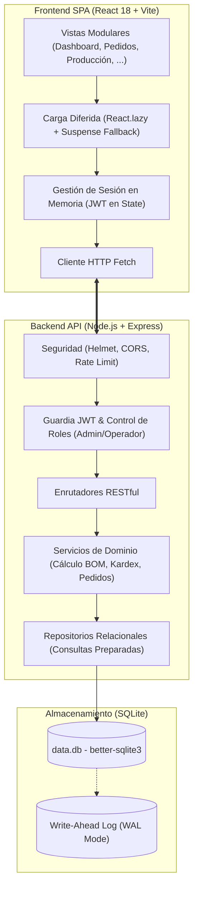

# CRM & Inventory Management Platform

Plataforma web full-stack de alto rendimiento diseñada para la gestión integral de clientes, catálogo de productos y materias primas, control de compras con trazabilidad Kardex, ciclo de vida de pedidos comerciales, ensamble con recetas de producción (BOM) y analítica de rentabilidad en tiempo real.

---

## El Problema que Resuelve

Las pequeñas y medianas empresas de manufactura, ensamble y distribución frecuentemente operan con herramientas desconectadas (múltiples hojas de cálculo propensas a errores humanos, desfasajes entre inventario físico y contable, falta de visibilidad en el costo unitario de fabricación y emisión manual de cotizaciones).

Esta plataforma centraliza y automatiza todo el flujo operativo en un único sistema coherente y auditable:

1. **Adquisición:** Registro de compras a proveedores con actualización inmediata de inventario y recálculo de costo promedio ponderado.
2. **Manufactura:** Modelado de recetas BOM (_Bill of Materials_) que descuentan insumos atómicamente, computan mano de obra y dan de alta productos terminados.
3. **Comercialización:** Cotización y venta con precios diferenciados por cliente, validación de stock disponible, cálculo de rentabilidad proyectada y emisión de proformas en PDF.
4. **Cobranza y Analítica:** Seguimiento de abonos parciales, cuentas por cobrar, estados de entrega y métricas financieras de costo de ventas (COGS).

---

## Principales Capacidades

### 1. Gestión Comercial y Clientes

- Directorio de clientes con datos de contacto, historial de pedidos y acuerdos de precios preferenciales por producto.
- Estados de activación lógica (activar/desactivar clientes sin romper la integridad referencial histórica).
- Buscador reactivo por coincidencia de nombre, contacto o correo.

### 2. Control de Inventario y Kardex

- Soporte dual de catálogo: **Productos Terminados** (para venta) y **Materias Primas / Insumos** (para ensamble).
- Control de rangos de precio (mínimo y máximo) y unidades de medida configurables.
- Trazabilidad total de movimientos de almacén mediante Kardex (`COMPRA`, `PEDIDO`, `PRODUCCION_ENTRADA`, `PRODUCCION_SALIDA`).
- Indicadores visuales y alertas automáticas ante niveles de stock por debajo del umbral mínimo.

### 3. Compras y Costeo Ponderado

- Módulo de compras a proveedores con registro detallado de renglones, cantidades y costos unitarios.
- Actualización automática del costo unitario promedio ponderado de inventario.

### 4. Ciclo de Pedidos y Cobranza

- Validación estricta de inventario disponible antes de confirmar cualquier orden.
- Cálculo de costos históricos de materiales, mano de obra y margen de utilidad proyectado por cada ítem del pedido.
- Soporte para abonos y pagos parciales con actualización dinámica de estados de cobro (`Pagado`, `Parcial`, `Pendiente`).
- Generación en el servidor de proformas comerciales en formato PDF con datos corporativos dinámicos.

### 5. Producción y Ensamble BOM (Bill of Materials)

- Definición de recetas de ensamble vinculando un producto terminado con múltiples materias primas y cantidades requeridas.
- Simulador de factibilidad que evalúa la disponibilidad de insumos en tiempo real antes de autorizar la producción.
- Transacciones atómicas de ensamble: descuentan materias primas, incorporan el costo de mano de obra y dan de alta el producto terminado.

### 6. Analítica y Reportes Financieros

- Tablero ejecutivo con KPIs en tiempo real: ventas totales, utilidad estimada, volumen de pedidos y productos en alerta.
- Gráficos interactivos de series temporales (facturación diaria/mensual) y rankings comerciales.
- Reportes exportables a formato CSV delimitado y XLSX bajo demanda.

### 7. Configuración del Sistema

- Persistencia centralizada en base de datos para tarifas de mano de obra y datos de identidad corporativa para proformas.

---

## Stack Tecnológico

| Capa                      | Tecnología                              | Propósito                                                                 |
| :------------------------ | :-------------------------------------- | :------------------------------------------------------------------------ |
| **Backend**               | **Node.js + Express**                   | Servidor API RESTful con arquitectura en capas.                           |
| **Persistencia**          | **SQLite (`better-sqlite3`)**           | Motor relacional embebido, modo WAL y transacciones ACID.                 |
| **Seguridad Backend**     | **Helmet + JWT + Bcryptjs**             | Cabeceras HTTP de seguridad, tokens de acceso y hash de contraseñas.      |
| **Validación de Datos**   | **Zod**                                 | Validación declarativa de esquemas de entrada en endpoints.               |
| **Generación Documental** | **PDFKit**                              | Maquetación y generación programática de proformas en PDF.                |
| **Frontend**              | **React 18 + Vite**                     | SPA modular con renderizado optimizado y recarga rápida.                  |
| **Enrutamiento**          | **React Router 7**                      | Navegación del lado del cliente con carga diferida (`React.lazy`).        |
| **Diseño y Estilos**      | **Tailwind CSS 4**                      | Motor LightningCSS de alto rendimiento, paleta Slate y diseño adaptativo. |
| **Visualización**         | **Recharts**                            | Gráficos vectoriales SVG dinámicos y adaptativos.                         |
| **Iconografía**           | **Lucide React**                        | Conjunto de iconos vectoriales accesibles y ligeros.                      |
| **Exportación**           | **write-excel-file**                    | Generación de hojas de cálculo XLSX importada bajo demanda.               |
| **Testing Backend**       | **Node.js Test Runner (`node --test`)** | 71 pruebas automatizadas de integración y servicios.                      |
| **Testing Frontend**      | **Vitest 4 + Testing Library**          | 25 pruebas unitarias y de integración de componentes.                     |
| **Calidad de Código**     | **ESLint 9 + Prettier**                 | Análisis estático y formateo estandarizado con cero advertencias.         |

---

## Arquitectura del Proyecto

El sistema aplica una arquitectura desacoplada y orientada al dominio:



Para consultar el desglose técnico detallado, los diagramas de secuencia de autenticación y los flujos transaccionales, revise [**`docs/architecture.md`**](docs/architecture.md).

---

## Estructura de Carpetas

```text
crm-portfolio/
├── .github/workflows/ci.yml # Canalización de Integración Continua
├── docs/                    # Especificaciones técnicas, arquitectura y seguridad
├── backend/
│   ├── scripts/             # Seeder demostrativo y scripts de administración
│   ├── src/
│   │   ├── repositories/    # Consultas SQL preparadas y transacciones atómicas
│   │   ├── schemas/         # Esquemas de validación con Zod
│   │   ├── services/        # Reglas de negocio, costeo y lógica de dominio
│   │   ├── config.js        # Configuración determinista de entorno
│   │   ├── db.js            # Esquema relacional, índices y migraciones
│   │   └── server.js        # API Express y controladores HTTP
│   └── tests/               # 71 pruebas automatizadas aisladas
├── frontend/
│   ├── src/
│   │   ├── api/             # Capa de consumo HTTP de la API
│   │   ├── components/      # Componentes UI reutilizables y accesibles (Modal, Badge, ...)
│   │   ├── pages/           # 10 vistas funcionales cargadas diferidamente
│   │   ├── App.jsx          # Shell de navegación y layout responsive
│   │   └── main.jsx         # Punto de entrada de la aplicación
│   └── tests/               # 25 pruebas de interfaz con Vitest y RTL
├── CONTRIBUTING.md          # Estándares de desarrollo y directrices de contribución
└── README.md                # Presentación general del proyecto
```

---

## Instalación y Ejecución Local

### Requisitos Previos

- **Node.js:** Versión 20.x LTS o superior (verificado con [`.nvmrc`](.nvmrc)).
- **npm:** Versión 10.x o superior.

### 1. Clonar e Instalar Dependencias

Instale las dependencias de forma reproducible utilizando `npm ci`:

```bash
# Instalar backend
cd backend
npm ci

# Instalar frontend
cd ../frontend
npm ci
```

### 2. Generar Datos Demostrativos Ficticios

Pueble la base de datos local con un catálogo completo de prueba:

```bash
cd ../backend
npm run seed:demo
```

_Este comando crea la base de datos relacional local en `backend/storage/data.db` de forma idempotente y segura._

### 3. Iniciar los Servidores de Desarrollo

Abra dos terminales independientes:

```bash
# Terminal 1: Iniciar API Backend
cd backend && npm run dev
# Disponible en: http://localhost:4000

# Terminal 2: Iniciar Cliente Frontend
cd frontend && npm run dev
# Disponible en: http://localhost:5173
```

---

## Credenciales de Acceso de Demostración

Una vez levantada la plataforma, ingrese en `http://localhost:5173/login`:

| Campo          | Credencial Demostrativa        |
| :------------- | :----------------------------- |
| **Email**      | `demo.admin@portfolio.invalid` |
| **Contraseña** | `local-demo-only-change-me`    |

> [!WARNING]
> **Advertencia de Seguridad:**
> Estas credenciales son de uso **estrictamente local** y funcionan únicamente con la base SQLite generada por el seeder demostrativo. No tienen validez ni correspondencia con ningún sistema productivo.

---

## Comandos de Verificación y Calidad

El proyecto mantiene una estricta política de **cero errores y cero advertencias**:

```bash
# Ejecutar suite de pruebas (71 tests backend, 25 tests frontend)
cd backend && npm test
cd ../frontend && npm test

# Análisis estático con ESLint (cero errores / cero warnings)
cd backend && npm run lint
cd ../frontend && npm run lint

# Verificación de formato con Prettier
cd backend && npm run format:check
cd ../frontend && npm run format:check

# Compilación de producción del cliente
cd ../frontend && npm run build
```

Para más detalles sobre los umbrales de validación previa a despliegue o contribución, consulte [**`docs/quality-gates.md`**](docs/quality-gates.md).

---

## Decisiones de Seguridad y Privacidad

1. **Gestión de Contraseñas:** Se eliminó cualquier soporte de contraseñas en texto plano. Todas las credenciales se almacenan procesadas mediante `bcrypt` con un costo de 10 rondas de salt.
2. **Tokens en Memoria (Zero Storage Policy):** El token JWT se conserva exclusivamente en la memoria de la aplicación React (`useState` / Context). **No se utiliza `localStorage` ni `sessionStorage`**, eliminando el vector de robo de credenciales vía ataques XSS.
3. **Ciclo de Vida de Sesión Efímero:** Al recargar la página (`F5`), la sesión se cierra intencionalmente por diseño de seguridad. La acción de cierre de sesión purga el estado de memoria del cliente.
4. **Protección Contra Fuerza Bruta:** El endpoint `/auth/login` implementa un limitador de tasa (_rate limiting_) que bloquea temporalmente peticiones abusivas tras múltiples intentos fallidos desde una misma IP.
5. **Endurecimiento de Cabeceras HTTP:** Implementación de `helmet` para configurar defensas contra clickjacking (`X-Frame-Options`), inyección MIME (`X-Content-Type-Options`) y políticas de referencia restrictivas.
6. **Protección de Datos en Consultas:** 100% de las consultas a base de datos utilizan sentencias preparadas parametrizadas para neutralizar cualquier riesgo de inyección SQL.

Para profundizar en el modelo de amenazas y mitigaciones, consulte [**`docs/security.md`**](docs/security.md).

---

## Rendimiento y Optimización del Frontend

La plataforma implementa una estrategia integral de optimización del tamaño del frontend:

- **Carga Diferida por Ruta (`React.lazy` + `Suspense`):** Las 10 vistas principales se descargan de forma asíncrona únicamente cuando el usuario navega hacia ellas.
- **Estado de Carga Accesible:** Indicador `PageLoadingFallback` con atributos WAI-ARIA (`role="status"`, `aria-live="polite"`, `aria-label="Cargando módulo"`).
- **Importación Dinámica del Motor de Exportación XLSX:** La librería de exportación a Excel (`write-excel-file/browser`) se desacopló mediante dynamic import y solo se descarga si el usuario hace clic en "Exportar XLSX".
- **División de Chunks en Rollup:** Desacoplamiento de librerías de terceros en fragmentos independientes (`vendor-react`, `vendor-recharts`, `vendor-icons`).

### Resultados de la Optimización:

- **Reducción del Bundle Inicial:** De **1,053.33 kB** a **~210 kB** sin comprimir (**-80.0% de reducción**).
- **Reducción de Transferencia (gzip):** De **306.38 kB** a **~67.8 kB** (**-77.9% de ahorro**).
- **Cero Advertencias de Build:** Se eliminaron todas las advertencias de fragmentos superiores a 500 kB en Vite.

Consulte el desglose de métricas y code-splitting en [**`docs/performance.md`**](docs/performance.md).

---

## Accesibilidad (a11y) y Diseño Adaptativo

- **Diseño con Criterios Inspirados en WCAG 2.1 AA:** Priorización de legibilidad y contraste en tipografías sobre la paleta Slate oscura. Se validaron labels asociados (`htmlFor`), indicadores de foco visible (`:focus-visible`), diálogos modales accesibles con atrapamiento de foco, navegación por teclado y regiones ARIA mediante pruebas automatizadas (Vitest + Testing Library) y revisión manual.
- **Componentes WAI-ARIA:**
  - `Modal`: Implementa `role="dialog"`, `aria-modal="true"`, captura de tecla `Escape`, atrapamiento de foco (_focus trap_) y retorno de foco al elemento activador.
  - `ToastContext`: Notificaciones en vivo con `role="status"` y región `aria-live="polite"`.
  - Formularios accesibles con etiquetas explícitas vinculadas mediante `htmlFor` y clases `.sr-only` para lectores de pantalla.
- **Navegación Asistida:** Enlace visible al recibir foco (_skip to main content link_) para usuarios de teclado.
- **Diseño Responsive:** Interfaz adaptable desde dispositivos móviles pequeños (375 px) con menú cajón (_drawer_) accesible hasta pantallas ultra-anchas. Tablas de datos complejas provistas de contenedores con desplazamiento horizontal suave.

Consulte los lineamientos de interfaz en [**`docs/ui-ux.md`**](docs/ui-ux.md).

---

## Limitaciones Conocidas y Posibles Mejoras

1. **Sesiones Volátiles:** La decisión de retener el token JWT exclusivamente en memoria requiere iniciar sesión nuevamente tras refrescar la pestaña. En una arquitectura orientada a retención comercial, se recomienda transicionar a cookies de sesión seguras con atributos `HttpOnly`, `Secure` y `SameSite=Strict`.
2. **Rate Limiting Distribuido:** El limitador de tasa actual almacena los contadores de intentos en la memoria del proceso Node.js. En despliegues en clúster con balanceo de carga, se sugiere integrar un almacén centralizado en Redis.
3. **Escalado de Persistencia:** SQLite ofrece una experiencia impecable y de latencia cero para instalaciones de nodo único y entornos de demostración. Si la organización requiere cientos de transacciones de escritura concurrentes por segundo, los repositorios desacoplados facilitan la migración del adaptador a PostgreSQL.

---

## Documentación Técnica Complementaria

- [**Arquitectura Técnica del Sistema**](docs/architecture.md): Capas, esquemas, transacciones y diagramas de flujo.
- [**Guía de Ejecución Local y Datos Demo**](docs/local-demo.md): Paso a paso detallado para pruebas y evaluación local.
- [**Umbrales de Calidad (Quality Gates)**](docs/quality-gates.md): Verificaciones obligatorias de pruebas, linting, compilación y auditoría de seguridad.
- [**Guía de Contribución**](CONTRIBUTING.md): Estándares de ingeniería y políticas de seguridad para colaboradores.
- [**Arquitectura de Seguridad**](docs/security.md): Modelo criptográfico, cabeceras y defensas contra ataques.
- [**Diseño UI/UX y Accesibilidad**](docs/ui-ux.md): Sistema de diseño, estándares WAI-ARIA y validación móvil.
- [**Rendimiento y Optimización de Bundle**](docs/performance.md): Estrategia de code-splitting, carga diferida y métricas de compilación.

---

## Licencia

Distribuido bajo la Licencia MIT. Consulte el archivo [`LICENSE`](LICENSE) para más información.
