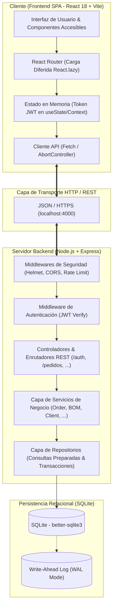
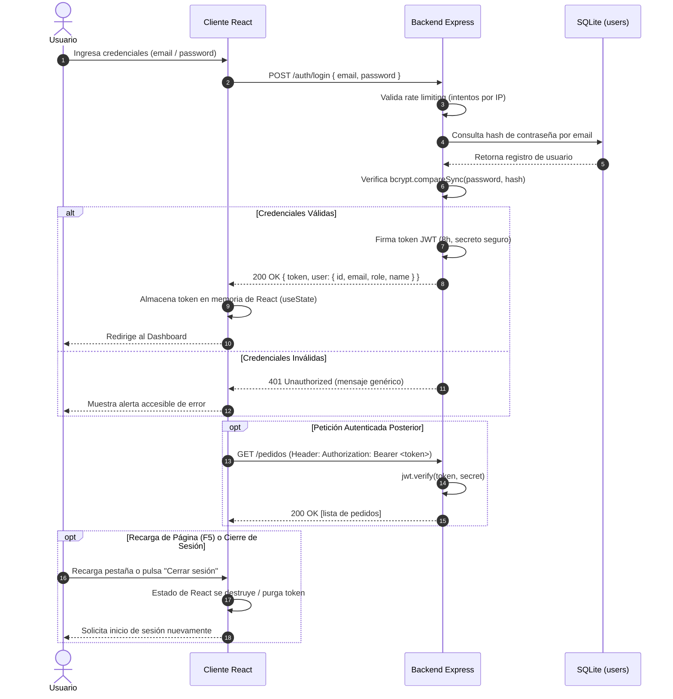

# Arquitectura del Sistema y Flujo de Datos

Este documento describe la arquitectura técnica, el diseño de capas, los flujos de información críticos y las decisiones de ingeniería adoptadas en la **CRM & Inventory Management Platform**.

---

## 1. Visión General de la Arquitectura

La plataforma sigue una arquitectura cliente-servidor desacoplada:

- **Frontend (Single Page Application):** Construido sobre React 18, empaquetado con Vite y estilizado con Tailwind CSS. Se encarga de la presentación interactiva, estado de interfaz accesible y visualización de métricas.
- **Backend (API RESTful):** Implementado en Node.js con Express, arquitectura por capas (rutas, servicios, repositorios) y base de datos relacional SQLite mediante el driver nativo `better-sqlite3`.
- **Protocolo de Comunicación:** Peticiones HTTP/1.1 con payloads JSON, securizadas con cabeceras de seguridad Helmet, limitador de tasa y autenticación mediante JSON Web Tokens (JWT) transmitidos en la cabecera `Authorization: Bearer <token>`.



---

## 2. Flujo de Autenticación JWT en Memoria

Para eliminar la superficie de ataque frente a vulnerabilidades de tipo Cross-Site Scripting (XSS), la aplicación no almacena credenciales ni tokens en `localStorage` o `sessionStorage`.



### Características del Modelo de Sesión:

1. **Retención Estricta en Memoria:** El token existe únicamente mientras la pestaña del navegador permanezca activa en ejecución de React.
2. **Expiración Determinista:** Al recargar (`F5`), el token se purga intencionalmente de la memoria.
3. **Cierre de Sesión Seguro en Cliente:** La acción de logout limpia el estado del cliente y desautoriza el consumo de la API de forma inmediata.

---

## 3. Capas de la Arquitectura Backend

El backend se organiza en capas estrictamente desacopladas para garantizar modularidad y testeabilidad:

```text
backend/src/
├── schemas/           # Validación de esquemas de entrada con Zod
├── repositories/      # Acceso directo a SQLite mediante sentencias preparadas
├── services/          # Lógica de dominio, reglas comerciales y cálculos de costeo
├── utils/             # Utilidades de registro de actividad estructurado (logger)
├── config.js          # Resolución determinista de configuración y variables de entorno
├── db.js              # Inicialización de SQLite, esquema relacional y migraciones
└── server.js          # Punto de entrada Express, rutas HTTP y middlewares globales
```

### 3.1. Rutas y Controladores (`server.js`)

- Gestiona el ciclo de vida de peticiones HTTP.
- Aplica validación sintáctica y de tipos mediante esquemas **Zod** (`backend/src/schemas/index.js`), rechazando payloads anómalos antes de tocar los servicios.
- Valida permisos basados en roles (`Admin` para configuración y usuarios; `Operador` para operaciones de inventario y pedidos).

### 3.2. Capa de Servicios (`services/*.js`)

- Implementa la lógica de negocio pura:
  - Verificación de suficiencia de inventario antes de autorizar un pedido.
  - Cálculo de precios personalizados acordados con clientes.
  - Costeo promedio ponderado de materias primas al procesar compras.
  - Validación de factibilidad de ensamble según recetas BOM (_Bill of Materials_).

### 3.3. Capa de Repositorios (`repositories/*.js`)

- Centraliza las consultas SQL contra la base de datos.
- Utiliza **consultas preparadas** (`db.prepare(...)`) para mitigar cualquier vector de inyección SQL.
- Implementa transacciones atómicas (`db.transaction(...)`) para operaciones compuestas que involucran múltiples tablas (ej. creación de pedido junto con su desglose de ítems y actualización de stock).

### 3.4. Motor de Persistencia Relacional (`db.js`)

- Utiliza `better-sqlite3`, ejecutado en el mismo hilo de Node.js mediante bindings en C, ofreciendo latencias submilimétricas sin la sobrecarga de conexiones TCP.
- Configuración de robustez:
  - `PRAGMA journal_mode = WAL`: Concurrencia de múltiples lectores simultáneos sin bloquear a un escritor.
  - `PRAGMA foreign_keys = ON`: Integridad referencial estricta a nivel de motor.

---

## 4. Flujos de Datos Principales

### 4.1. Flujo de Creación de Pedido

1. El usuario selecciona un cliente y agrega productos terminados con cantidades y precios acordados.
2. El servicio valida que exista stock disponible para cada producto solicitado.
3. Se inicia una transacción atómica:
   - Se crea el registro maestro en `orders`.
   - Se insertan los renglones individuales en `order_items`.
   - Se calcula el costo de materiales histórico, costo de mano de obra y margen de utilidad proyectado.
   - Se descuenta el inventario en `products` y se registra el movimiento en `stock_movements`.
4. Si el pedido incluye abono inicial, se registra en `order_payments`, actualizando el estado de cobro a "Pagado" o "Parcial".
5. Si se solicita proforma comercial, `proformaPdf.js` genera un documento PDF maquetado con los datos corporativos vigentes (`companyInfo`).

### 4.2. Flujo de Compra y Actualización de Kardex

1. El usuario registra la adquisición de materias primas o insumos indicando proveedor, cantidades y costos unitarios.
2. El servicio ejecuta una transacción atómica:
   - Registra la cabecera en `purchases` y el detalle en `purchase_items`.
   - Genera los registros de trazabilidad en `kardex_movements` con tipo `COMPRA`.
   - Recalcula el costo unitario del producto y actualiza `stockActual` en `products`.

### 4.3. Flujo de Producción y Ensamble BOM (Bill of Materials)

1. Para ensamblar un Producto Terminado (PT), el sistema consulta su receta en `bom_items`.
2. Se verifica que el inventario de todas las materias primas requeridas sea suficiente para la cantidad a producir.
3. Se calcula el costo total de materiales y se adiciona el costo unitario de mano de obra configurado en el sistema (`costo_mano_obra_unitaria`).
4. Se ejecuta la transacción de producción:
   - Descuenta el stock de materias primas e inserta movimientos en Kardex (`PRODUCCION_SALIDA`).
   - Incrementa el stock del producto terminado e inserta movimiento en Kardex (`PRODUCCION_ENTRADA`).
   - Registra la orden de ensamble en `assembly_orders` con el costo de fabricación resultante.

---

## 5. Estrategia de Configuración y Datos Demo

### Configuración Determinista (`config.js`)

- En desarrollo local, la aplicación no requiere archivos `.env` obligatorios: genera claves seguras en memoria y utiliza rutas relativas por defecto (`backend/storage/data.db`).
- En entorno de producción (`NODE_ENV=production`), el servidor exige obligatoriamente variables explícitas para secreto JWT (`JWT_SECRET`), orígenes permitidos (`CORS_ORIGIN`) y rutas a volúmenes persistentes (`DB_PATH`, `STORAGE_DIR`).

### Datos Demostrativos Ficticios (`seed-demo.js`)

- Permite poblar una base local reproducible con identidades sintéticas (dominios `.invalid`, números ficticios y catálogos estándar).
- El seeder es estrictamente **idempotente** (puede reejecutarse sin duplicar registros) y cuenta con un guardián que rechaza su ejecución en entornos de producción.

---

## 6. Justificación Técnica del Uso de SQLite

Para este proyecto de portafolio técnico, SQLite fue seleccionado frente a motores cliente-servidor externos (como PostgreSQL o MySQL) por razones estratégicas:

1. **Portabilidad y Cero Fricción:** Permite a evaluadores técnicos, reclutadores y revisores clonar el proyecto y ejecutarlo en 60 segundos con `npm ci` y `npm run seed:demo`, sin requerir la instalación ni configuración de contenedores Docker, demonios externos o credenciales de bases de datos.
2. **Rendimiento Máximo en Nodo Único:** Mediante `better-sqlite3`, las operaciones SQL son llamadas directas a funciones C en memoria compartida, eliminando la latencia de serialización de sockets de red.
3. **Integridad Relacional Completa:** Soporta transacciones ACID completas, claves foráneas, índices compuestos y aislamiento WAL.
4. **Reproducibilidad en Pruebas Automatizadas:** Cada suite de pruebas crea una base temporal aislada en milisegundos en `os.tmpdir()`, permitiendo 71 pruebas de backend rápidas y concurrentes sin interferencia de estado.

---

## 7. Límites Conocidos y Posibles Mejoras

1. **Escalado Horizontal:** El contador de rate limiting opera en la memoria del proceso Express. En una arquitectura de múltiples réplicas en clúster, se requeriría un almacén distribuido como Redis.
2. **Sesiones Volátiles:** El modelo de JWT en memoria exige autenticarse nuevamente tras recargar la página. Una alternativa comercial sería emplear cookies HTTP-only con atributo `SameSite=Strict`.
3. **Concurrencia de Escritura SQLite:** Aunque el modo WAL permite lectores concurrentes, las escrituras en SQLite se serializan mediante un bloqueo de archivo único. Para volúmenes empresariales de alta escritura concurrente, la arquitectura de repositorios está desacoplada para facilitar la migración a PostgreSQL.
